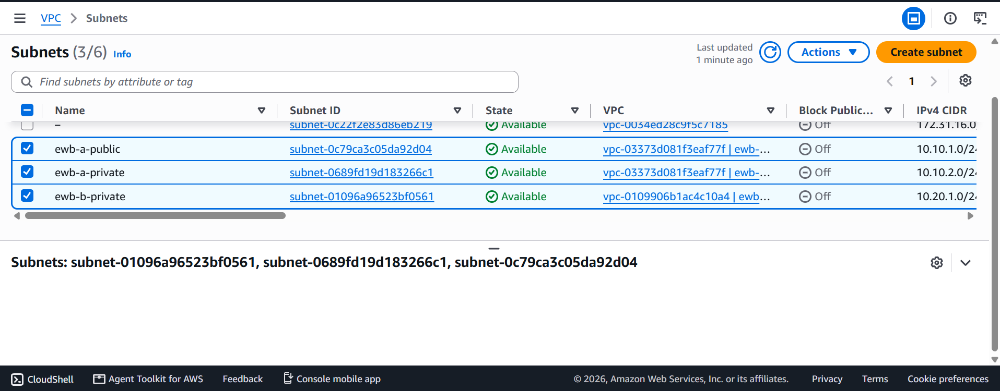
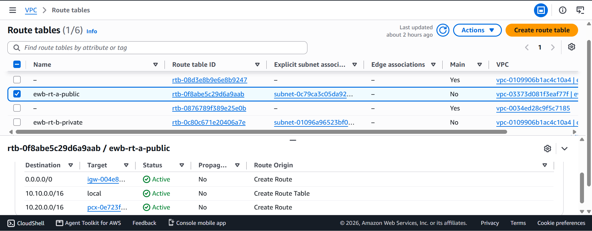
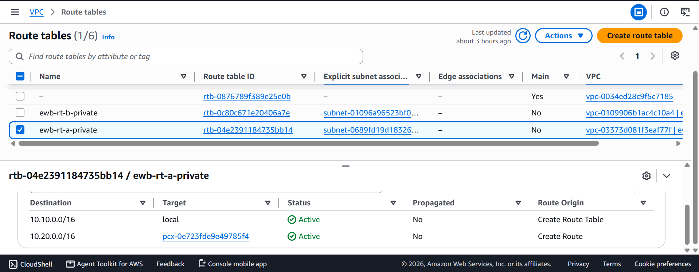
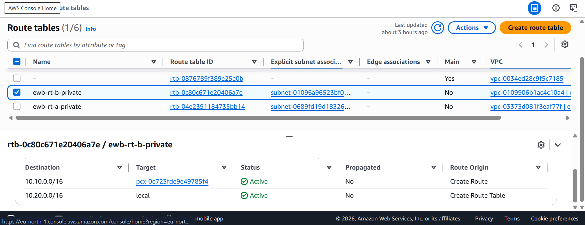
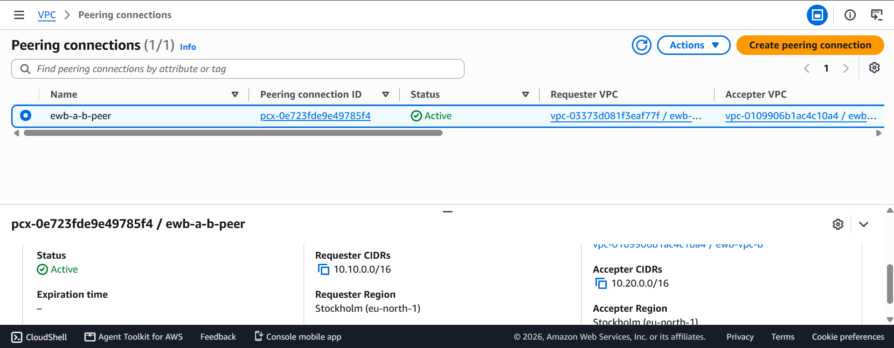
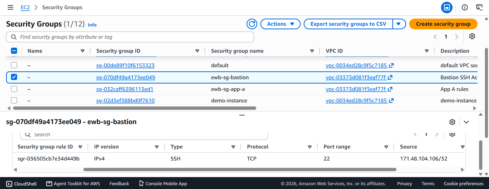
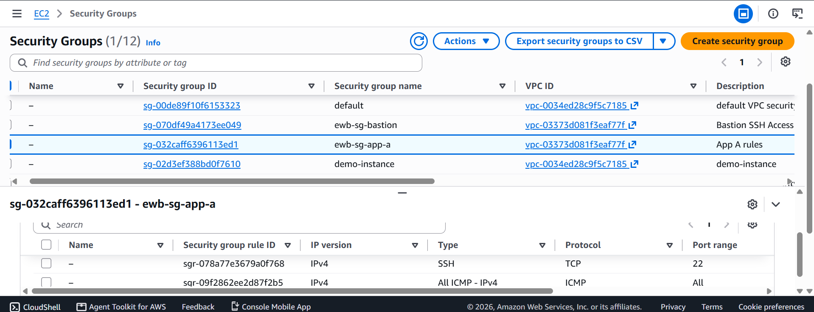
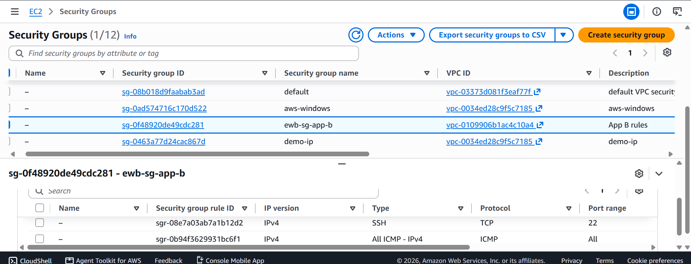

# EWB VPC Peering Project Report

**Name:** [Kashika Ghosh]
**Region:** Europe (Stockholm) / eu-north-1

## 1. Architecture and IP Plan
* **VPC A:** `10.10.0.0/16`
* **VPC B:** `10.20.0.0/16`
* **Design:** Non-overlapping CIDRs to allow VPC Peering.

## 2. Resource Inventory
* **Bastion:** `10.10.1.10` (Public IP enabled)
* **App-A:** `10.10.2.10` (No Public IP)
* **App-B:** `10.20.1.10` (No Public IP)

## 3. Route Table Configurations

## 4. VPC Peering Connection

## 5. Security Groups

## 6. Verification and Testing Evidence

### Test 1: Forward Path (App-A to App-B)

### Test 2: Controlled Failure

### Test 3: Reverse Path (App-B to App-A)

## 7. Conclusion
The project successfully demonstrated how to build a secure, multi-VPC architecture using AWS VPC Peering. By utilizing a Bastion host and strict Security Group rules, the private workloads were able to communicate securely without being exposed to the public internet.