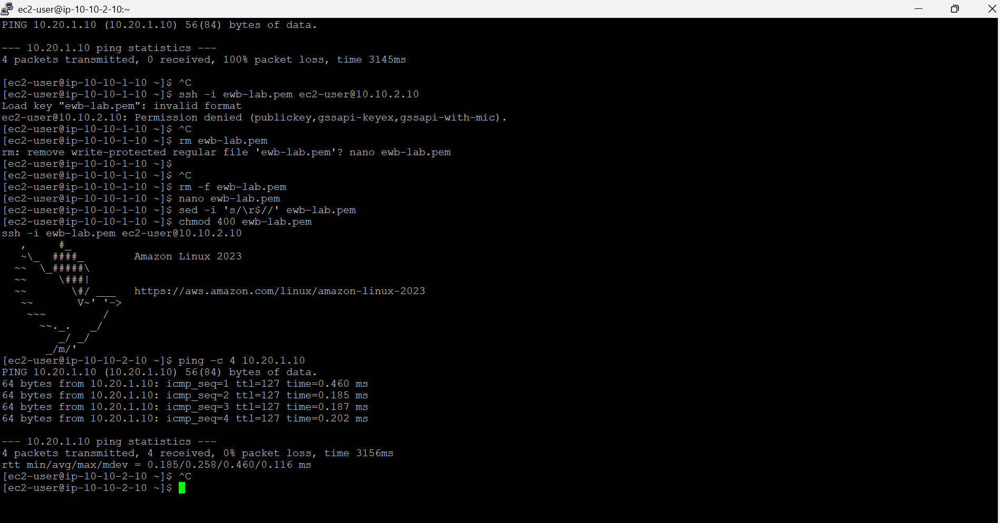
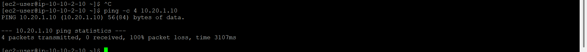
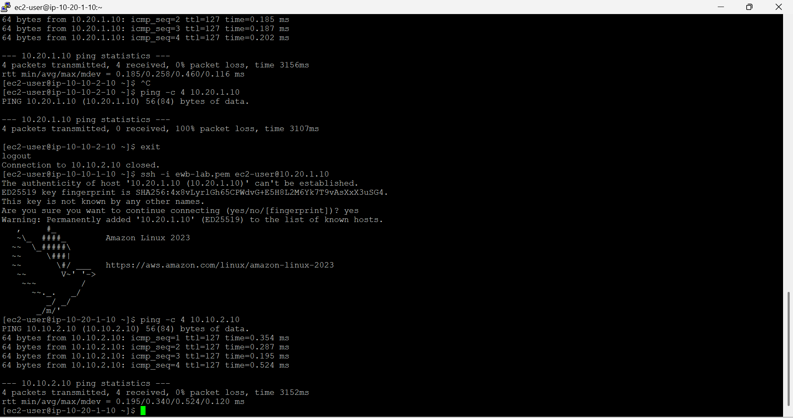

<div align="center">
  <h1>AWS Multi-VPC Peering & Secure Bastion Architecture</h1>
  <p><i>A secure, production-grade multi-VPC network built on AWS</i></p>
</div>

---

## 📌 Project Overview
This project demonstrates a secure, multi-VPC architecture on AWS. The objective was to establish a private connection between two isolated workloads (VPC A and VPC B) using **AWS VPC Peering**, ensuring that backend application servers remain completely private, secure, and unexposed to the public internet.

<br>

## 🏗️ Architecture Diagram

<div align="center">
  <!-- Replace 'architecture.png' with your exact file name if it is different -->
  
</div>

<br>

---

## 🛠️ AWS Services & Technologies Used
| Service | Purpose |
| :--- | :--- |
| **Amazon VPC** | Isolated network environments with non-overlapping CIDRs. |
| **Amazon EC2** | Amazon Linux 2023 instances (`t3.micro`) for compute. |
| **VPC Peering** | Private, direct connection between VPCs. |
| **Internet Gateway** | Provides internet access strictly to the public subnet. |
| **Bastion Host** | A secure jump box for administrative SSH access. |
| **Route Tables** | Granular traffic routing across subnets. |
| **Security Groups** | Stateful firewalls enforcing a Zero Trust model. |

---

## 🗺️ Network Topology & IP Allocation

| Resource | VPC | Subnet Type | Private IPv4 | Public IPv4 |
| :--- | :--- | :--- | :--- | :--- |
| **ewb-bastion** | VPC A (`10.10.0.0/16`) | Public | `10.10.1.10` | ✅ Enabled |
| **ewb-app-a** | VPC A (`10.10.0.0/16`) | Private | `10.10.2.10` | ❌ Disabled |
| **ewb-app-b** | VPC B (`10.20.0.0/16`) | Private | `10.20.1.10` | ❌ Disabled |

---

## 🚦 Routing & Security Configuration

### 1. VPC Peering Connection
*   **Peering ID:** `ewb-a-b-peer`
*   **Status:** `Active`
*   **Routing:** Private route tables in both VPCs route cross-VPC traffic via the `pcx-` target.

### 2. Security Groups (Zero Trust Model)
*   **`ewb-sg-bastion`:** Allows SSH (Port 22) **only** from the Admin's public IP.
*   **`ewb-sg-app-a`:** Allows SSH **only** from the Bastion (`10.10.1.10`), and ICMP (Ping) **only** from App-B (`10.20.1.10`).
*   **`ewb-sg-app-b`:** Allows SSH **only** from the Bastion (`10.10.1.10`), and ICMP (Ping) **only** from App-A (`10.10.2.10`).

---

## 🧪 Verification & Testing Evidence
To prove the architecture works, SSH key forwarding was used to jump from the Bastion into the private instances, and ICMP tests were executed.

### Test 1: Forward Path (App-A to App-B)
Successfully verified private communication over the peering connection (0% packet loss).
<div align="center">
  
</div>

### Test 2: Controlled Failure (Firewall Validation)
To prove the Security Groups enforce rules, the ICMP rule on App-B was temporarily removed. The ping failed, proving the firewall is active.
<div align="center">
  
</div>

### Test 3: Reverse Path (App-B to App-A)
Successfully verified bi-directional communication across the peering connection.
<div align="center">
  
</div>

---

## 📂 Repository Structure
```text
AWS-VPC-Peering/
├── README.md                 <-- Project overview and architecture
├── images/                   <-- All verification screenshots
├── configs/                  <-- Route table & Security group configs
└── Project_Report.md         <-- Detailed assignment report
<div align="center"> <h3>Author: Kashika Ghosh</h3> <p> <a href="https://github.com/kashikaaa06">GitHub Profile</a> </p> </div> 
