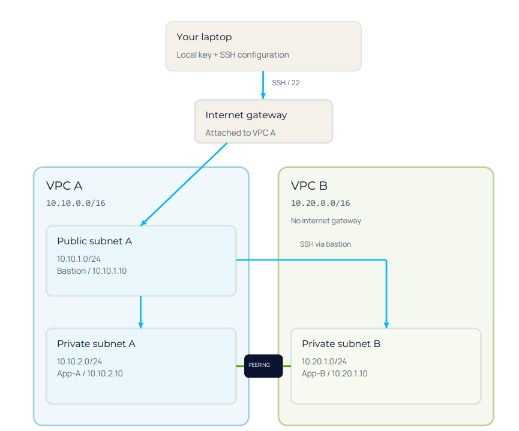

# AWS Multi-VPC Peering and Secure Bastion Architecture

## Project Overview
This project demonstrates a secure, multi-VPC architecture on AWS. The objective was to establish a private network connection between two isolated workloads (VPC A and VPC B) using AWS VPC Peering. This ensures that backend application servers remain completely private and unexposed to the public internet, while still allowing administrative access via a secure Bastion host.

## Architecture Diagram

  

---

## AWS Services and Technologies Used
*   **Amazon VPC:** Isolated network environments provisioned with non-overlapping CIDR blocks.
*   **Amazon EC2:** Amazon Linux 2023 instances utilized for compute workloads.
*   **VPC Peering:** Private, direct network connection established between two VPCs to route traffic using private IPv4 addresses.
*   **Internet Gateway (IGW):** Provides internet routing exclusively to the public subnet within VPC A.
*   **Bastion Host:** A hardened, public-facing EC2 instance acting as a secure jump box for administrative SSH access to private resources.
*   **Route Tables:** Custom route tables configured to direct local and cross-VPC traffic accurately.
*   **Security Groups:** Stateful firewalls enforcing a Zero Trust security model.

---

## Resource Inventory

| Resource Name | VPC | Subnet Type | Private IPv4 | Public IPv4 |
| :--- | :--- | :--- | :--- | :--- |
| `ewb-bastion` | VPC A (`10.10.0.0/16`) | Public | `10.10.1.10` | Assigned |
| `ewb-app-a` | VPC A (`10.10.0.0/16`) | Private | `10.10.2.10` | None |
| `ewb-app-b` | VPC B (`10.20.0.0/16`) | Private | `10.20.1.10` | None |

---

## Routing and Security Configuration

### 1. VPC Peering Connection
A peering connection (`ewb-a-b-peer`) was established and accepted between VPC A and VPC B.
*   **Status:** Active
*   **Routes:** Both private route tables are configured to route cross-VPC traffic (`10.20.0.0/16` and `10.10.0.0/16`) through the `pcx-` target.

### 2. Security Groups (Zero Trust Model)
Strict security group rules were implemented to prevent lateral movement and unauthorized access:
*   **ewb-sg-bastion:** Allows SSH (Port 22) only from the administrator's specific public IP address.
*   **ewb-sg-app-a:** Allows SSH only from the Bastion's private IP (`10.10.1.10`), and ICMP (Ping) only from App-B (`10.20.1.10`).
*   **ewb-sg-app-b:** Allows SSH only from the Bastion's private IP (`10.10.1.10`), and ICMP (Ping) only from App-A (`10.10.2.10`).

---

## Verification and Testing Evidence

### Test 1: Forward Path (App-A to App-B)
Successfully verified private communication over the peering connection (0% packet loss).

### Test 2: Controlled Failure (Firewall Validation)
To prove the Security Groups are actively enforcing rules, the ICMP rule on App-B was temporarily removed. The ping failed, proving the firewall works as intended.

### Test 3: Reverse Path (App-B to App-A)
Successfully verified bi-directional communication across the peering connection.

---

## Repository Structure
*   `README.md` - Project overview and architecture.
*   `images/` - Contains all verification screenshots and diagrams.
*   `configs/` - Contains Markdown files detailing the exact Route Table and Security Group configurations.
*   `Project_Report.md` - The detailed, step-by-step project report.

---

## Author
**Kashika Ghosh**
*   GitHub: [@kashikaaa06](https://github.com/kashikaaa06)
